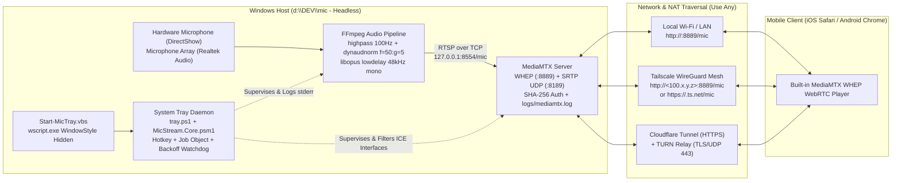

# Headless Windows-to-Mobile WebRTC Audio Streaming Architecture

## 1. Executive Summary & Design Goals

This workspace (`d:\DEV\mic`) implements a low-latency (under 500 ms), zero-footprint ambient audio monitoring and recording system on Windows. It captures live microphone audio via FFmpeg, ingests it locally over loopback TCP RTSP into MediaMTX, and streams authenticated WebRTC audio (WHEP + SRTP) to mobile browsers across **Local Wi-Fi/LAN**, **Tailscale WireGuard**, or **Cloudflare Named Tunnel + VPS `coturn` TURN**, controlled via a headless Windows System Tray daemon, an optional clickable Control Panel window, and conflict-free global hotkeys (`Ctrl + Shift + F9` for stream, `Ctrl + Shift + F10` for recording).

### Core Capabilities
- **Zero Host UI Footprint:** Launched silently via `wscript.exe` (`Start-MicTray.vbs`); no console window flashes or remains visible.
- **Sub-500 ms Audio Pipeline:** DirectShow 50 ms capture buffer -> `highpass=f=100` -> low-latency `dynaudnorm=f=50:g=5:m=10` (~100–150 ms lookahead instead of >1,100 ms with larger Gaussian windows) -> `libopus` (`lowdelay`, 20 ms frames, 48 kHz mono, 48 kbps).
- **Hardened Process Supervision:** Single-instance mutex, kernel-enforced Win32 Job Object (`JOB_OBJECT_LIMIT_KILL_ON_JOB_CLOSE`) to prevent orphaned audio processes, TCP readiness probing on `127.0.0.1:8554`, exponential watchdog backoff, and rotating file logs in `logs/`.
- **Zero-Trust Auth & Multi-Transport Ready:** Loopback-only RTSP publishing (`127.0.0.1:8554`), SHA-256 hashed remote listener credentials (`authInternalUsers`), dynamic WebRTC ICE interface filtering (ignoring virtual/VPN/APIPA noise), and seamless support for LAN, Tailscale, and Cloudflare Tunnel + TURN.

---

## 2. Four-Plane System Topology



---

## 3. Directory Layout

```text
d:\DEV\mic\
├── ARCHITECTURE.md               # System architecture, multi-transport guides & runbook
├── .gitignore                    # Excludes mediamtx.exe, mediamtx.yml, config.json, logs/
├── config.example.json           # Committed default tray & audio configuration template
├── config.json                   # Local active configuration (gitignored)
├── mediamtx.example.yml          # Committed hardened MediaMTX template
├── mediamtx.yml                  # Local active MediaMTX config with SHA-256 hash (gitignored)
├── mediamtx.exe                  # Official MediaMTX Windows amd64 binary (gitignored)
├── tray.ps1                      # Headless System Tray controller, hotkey, job object & watchdog
├── Start-MicTray.vbs             # Silent zero-window launcher
├── lib\
│   └── MicStream.Core.psm1       # Testable core module (quoting, hashing, parsing, networking)
├── scripts\
│   ├── Install-MediaMTX.ps1      # Downloads/verifies official MediaMTX binary & seeds configs
│   ├── Set-StreamPassword.ps1    # Sets SHA-256 base64 listener password in mediamtx.yml
│   └── Check-Environment.ps1     # Read-only host & transport diagnostic doctor
├── tests\
│   └── MicStream.Core.Tests.ps1  # Automated Pester 3.4 unit tests
└── logs\                         # Rotating runtime logs (tray.log, mediamtx.log, ffmpeg.log)
```

---

## 4. Quickstart

Run from PowerShell inside `d:\DEV\mic`:

1. **Download MediaMTX & seed local configs** (if not already installed):
   ```powershell
   .\scripts\Install-MediaMTX.ps1
   ```
2. **Set your remote listener password** (stored strictly as a MediaMTX `sha256:` base64 hash):
   ```powershell
   .\scripts\Set-StreamPassword.ps1
   ```
3. **Verify host readiness & view reachable stream URLs**:
   ```powershell
   .\scripts\Check-Environment.ps1
   ```
4. **Launch the headless tray daemon**:
   - Double-click `Start-MicTray.vbs` (or run `wscript.exe .\Start-MicTray.vbs`).
   - Press `Ctrl + Alt + M` (or double-click / right-click the tray icon -> **Start Stream**).
   - Right-click tray icon -> **Copy Stream URL** to copy your active LAN, Tailscale, or Tunnel URL.

---

## 5. Multi-Transport Network Playbooks (Use Any)

`tray.ps1` automatically filters out virtual/VPN/APIPA adapters (`VMware*`, `vEthernet*`, `WSL*`, `ProtonVPN*`, `Surfshark*`, `169.254.*`) via `MTX_WEBRTCIPSFROMINTERFACESLIST` so WebRTC ICE negotiates cleanly on your real interfaces. You can disable automatic filtering by setting `network.autoFilterInterfaces` to `false` in `config.json`.

### Mode A — Local Wi-Fi / LAN (Immediate Same-Network Access)
1. Ensure Windows Defender Firewall allows inbound TCP `8889` and UDP `8189` (Section 6).
2. Connect your phone to the same Wi-Fi network.
3. Right-click the tray icon -> **Copy Stream URL** -> **LAN - Wi-Fi (...)** (`http://<LAN-IP>:8889/mic`).
4. Sign in with `admin` and the password you set via `Set-StreamPassword.ps1`, then tap unmute/play.

### Mode B — Tailscale WireGuard Mesh (Recommended Remote Access)
1. Install Tailscale on Windows (`winget install Tailscale.Tailscale`) and on your mobile device, then sign into the same tailnet.
2. **ProtonVPN Coexistence:** If ProtonVPN is active on the laptop simultaneously, enable Split Tunneling in ProtonVPN to exclude `100.64.0.0/10` (Tailscale CGNAT range), or pause ProtonVPN while streaming over Tailscale.
3. Restart the stream (`Ctrl + Alt + M` twice) so `tray.ps1` detects the active `Tailscale` interface automatically.
4. Connect from mobile using either:
   - **Direct Tailscale HTTP:** `http://<100.x.y.z>:8889/mic` (appears automatically under **Copy Stream URL**).
   - **Optional Trusted HTTPS (best for iOS Safari / Android Chrome):** Enable HTTPS in your Tailscale admin console, then run:
     ```powershell
     tailscale serve --bg https / http://127.0.0.1:8889
     ```
     MediaMTX already trusts `127.0.0.1` via `webrtcTrustedProxies`, and **Copy Stream URL** will automatically offer `https://<your-host>.<tailnet>.ts.net/mic`.

### Mode C — Cloudflare Named Tunnel + Self-Hosted VPS `coturn` TURN Relay (No VPN App / ProtonVPN Friendly / Unlimited Hours)
> **Important:** Cloudflare Tunnel proxies HTTP/HTTPS (WHEP signaling on `:8889`) only—it does **not** carry raw UDP (`:8189`). Pairing it with a lightweight `coturn` Docker container on your Ubuntu VPS gives unlimited 24/7 audio relay (~16 GB/mo continuous) with zero expiring API tokens.

1. **Deploy `coturn` on your Ubuntu VPS** using the ready-made files in `d:\DEV\mic\vps\coturn\` (`docker-compose.yml`, `turnserver.conf.example`, and `README.md`).
2. **Create a Named Tunnel** in Cloudflare Zero Trust (`Networks -> Tunnels`) mapping `https://mic.yourdomain.com` -> `http://127.0.0.1:8889`, and copy the tunnel token.
3. **Run the laptop setup wizard:** Double-click **`5-Configure-Remote.bat`** (runs `scripts\Configure-Remote.ps1`) to:
   - Save your public URL (`config.json`), tunnel token (`cloudflared.token`, gitignored), and VPS TURN `AUTH_SECRET` (`mediamtx.yml`).
   - Download `cloudflared.exe` locally into `d:\DEV\mic\`.
4. **Toggle Cloudflare Tunnel optionally anytime:** Check or uncheck **Start Cloudflare Tunnel with stream (Optional)** in the Control Panel (`0-Open-Control-Panel.bat`) or right-click the tray dot -> **Cloudflare Tunnel (Optional)**. When checked, `cloudflared.exe` starts and stops automatically alongside the stream!

---

## 6. Manual Windows Host Provisioning Checklist

Run these steps manually as needed (this project intentionally does not modify Windows Firewall, Startup, or Power settings automatically):

1. **Windows Defender Firewall Rules (Run in an Elevated / Administrator PowerShell):**
   ```powershell
   New-NetFirewallRule -DisplayName "MediaMTX Signaling TCP" -Direction Inbound -Protocol TCP -LocalPort 8889 -Profile Private -Action Allow
   New-NetFirewallRule -DisplayName "MediaMTX WebRTC UDP" -Direction Inbound -Protocol UDP -LocalPort 8189 -Profile Private -Action Allow
   ```
   *(If you use Tailscale over a Public network profile, change `-Profile Private` to `-Profile Private,Public` or scope to `-RemoteAddress 100.64.0.0/10`.)*

2. **Power Management on AC Power (Optional — Run in Elevated PowerShell):**
   Verify AC sleep stays `0` (Never) and optionally set AC display sleep to 5 minutes:
   ```powershell
   powercfg /change standby-timeout-ac 0
   powercfg /change monitor-timeout-ac 5
   ```

3. **Windows Microphone Privacy Permissions:**
   - Open **Settings -> Privacy & security -> Microphone**.
   - Ensure **Microphone access** and **Let desktop apps access your microphone** are both **On**.

4. **Auto-Start on Windows Login (Optional):**
   - Press `Win + R`, run `shell:startup`.
   - Right-click inside the Startup folder -> **New -> Shortcut**.
   - Target: `wscript.exe "d:\DEV\mic\Start-MicTray.vbs"`
   - Name: `MicStream Tray`.

---

## 7. Operational Runbook & Troubleshooting

### System Tray Status Colors
| Tray Dot Color | State | Meaning |
| :--- | :--- | :--- |
| **Gray** | `Stopped` | Daemon idle; microphone, recorder, and server are OFF. |
| **LimeGreen** | `LIVE` | MediaMTX + FFmpeg verified healthy and streaming audio. |
| **LimeGreen + Red center dot** | `LIVE + REC` | Live WebRTC stream AND local MP3 recording are both active. |
| **Crimson (Red)** | `REC Only` | Local MP3 recording active while live WebRTC stream is OFF. |
| **Orange** | `Starting` / `Recovering` | Startup handshake or watchdog exponential backoff recovery in progress. |
| **DarkRed** | `Error` | Setup missing or auto-recovery paused after repeated failures (open `logs/`). |

### Controls Reference
| Operation | Action |
| :--- | :--- |
| **Open Clickable Control Panel** | Double-click `0-Open-Control-Panel.bat` or **left-click** the tray dot |
| **Start Daemon Silently** | Double-click `1-Start-MicTray.bat` (or `Start-MicTray.vbs`) |
| **Toggle Live Stream On / Off** | Press **`Ctrl + Shift + F9`**, or click **Start / Stop Stream** in Control Panel or tray menu |
| **Toggle Optional Cloudflare Tunnel** | Check/uncheck **Start Cloudflare Tunnel with stream** in Control Panel or tray menu |
| **Start / Stop Recording** | Press **`Ctrl + Shift + F10`**, or click **Start / Stop Recording** in Control Panel or tray menu |
| **Set Recording Auto-Stop Timer** | Pick `Manual`, `5/10/15/30/60/120 min`, or `Custom (1-1440 min)` in Control Panel or tray menu |
| **Open Saved MP3 Recordings** | Click **Open Recordings** (`d:\DEV\mic\recordings\mic_YYYY-MM-DD_HH-mm-ss.mp3`) |
| **Emergency Stop Everything** | Click **Exit Completely** in Control Panel / tray menu, or double-click `2-Stop-Everything.bat` |
| **Check Live Status & URLs** | Double-click `3-Check-Status.bat` |
| **Change Stream Password** | Double-click `4-Change-Password.bat` |
| **Configure Cloudflare + VPS TURN** | Double-click `5-Configure-Remote.bat` |

### Troubleshooting Matrix
- **No sound on mobile browser:** Tap the unmute/play control on the player (iOS Safari and Android Chrome block unmuted autoplay before a user gesture).
- **Mobile browser prompts fail or reject plain HTTP:** Use `tailscale serve` HTTPS (Mode B) or Cloudflare Tunnel HTTPS (Mode C) for a trusted TLS certificate.
- **Connection hangs on cellular 4G/5G:** Confirm Tailscale is connected on both laptop and phone (and not blocked by ProtonVPN), or verify `webrtcICEServers2` TURN credentials when using Cloudflare Tunnel.
- **Tray turns Orange then Red:** Click **Open Logs Folder** and inspect `logs\ffmpeg.log` (wrong/locked microphone) and `logs\mediamtx.log` (invalid YAML or port conflict).
- **Audio latency feels > 500 ms:** Confirm `config.json` uses `dynaudnormFrameMs: 50` and `dynaudnormGaussSize: 5` (or disable Ambient Boost to test raw capture latency).
- **Verify tests anytime:**
  ```powershell
  Invoke-Pester -Path "d:\DEV\mic\tests\MicStream.Core.Tests.ps1" -EnableExit
  ```
